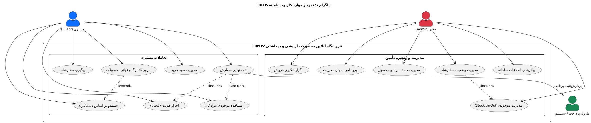
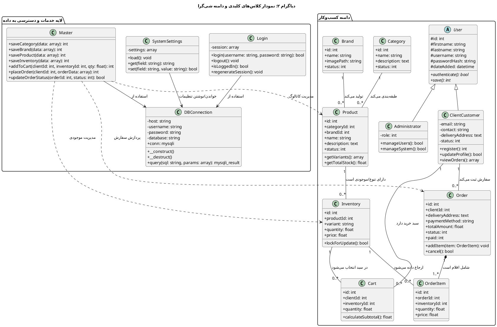
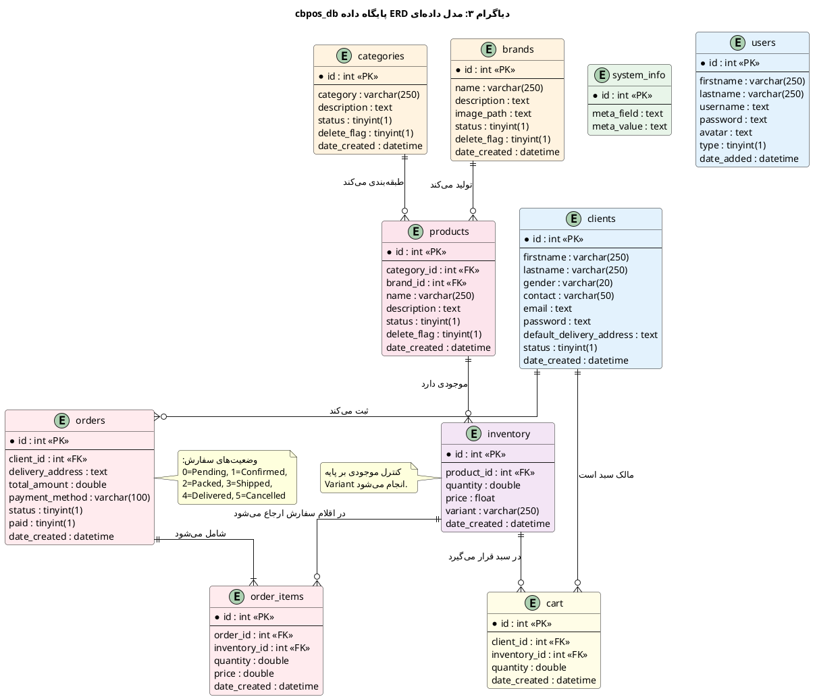
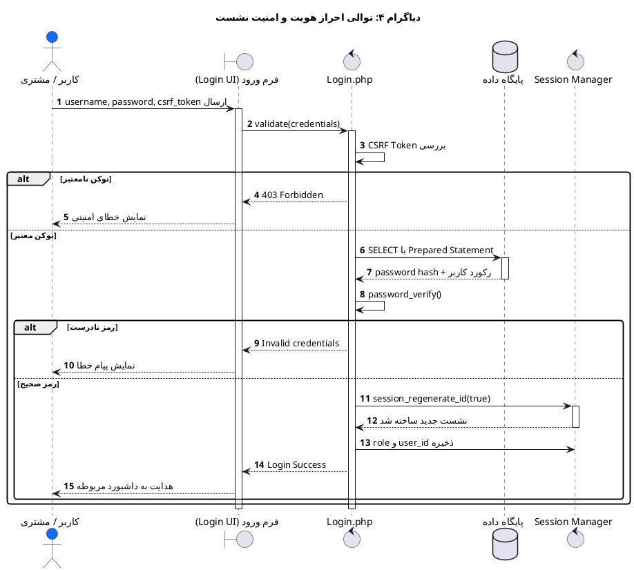
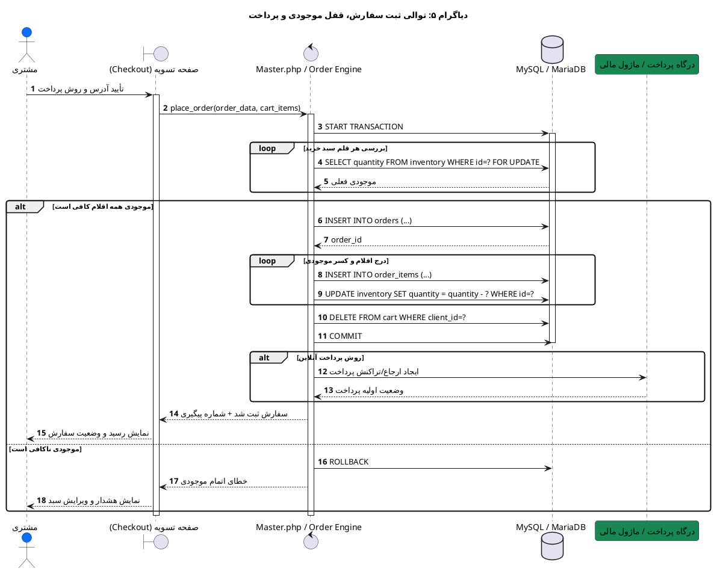
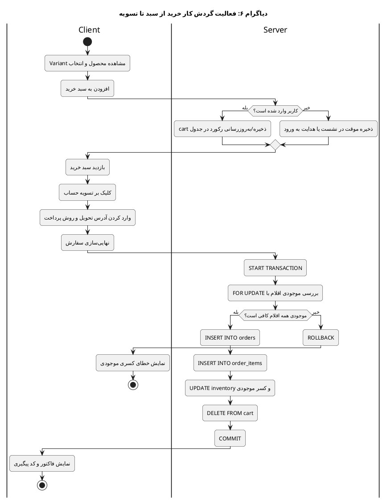
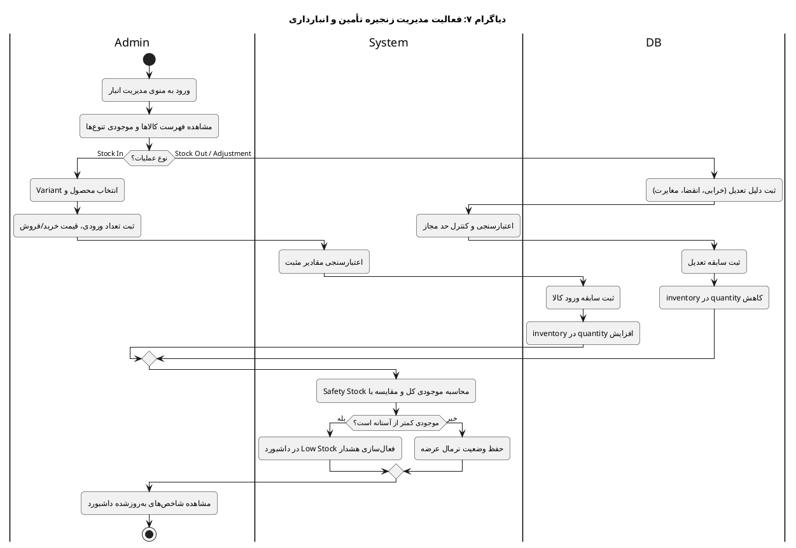
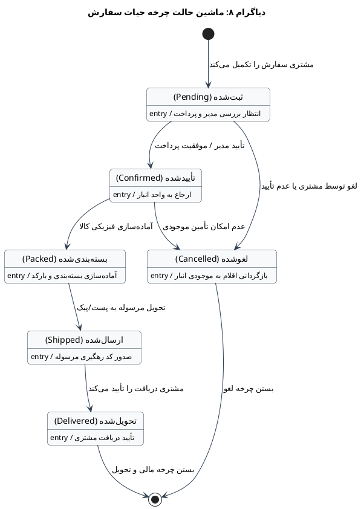
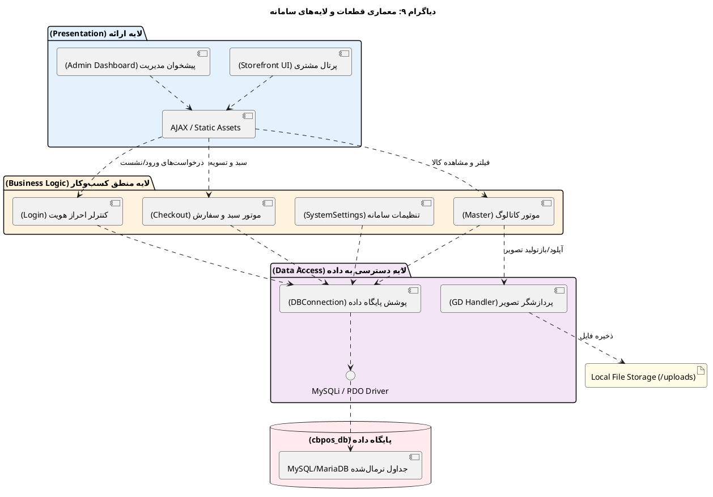
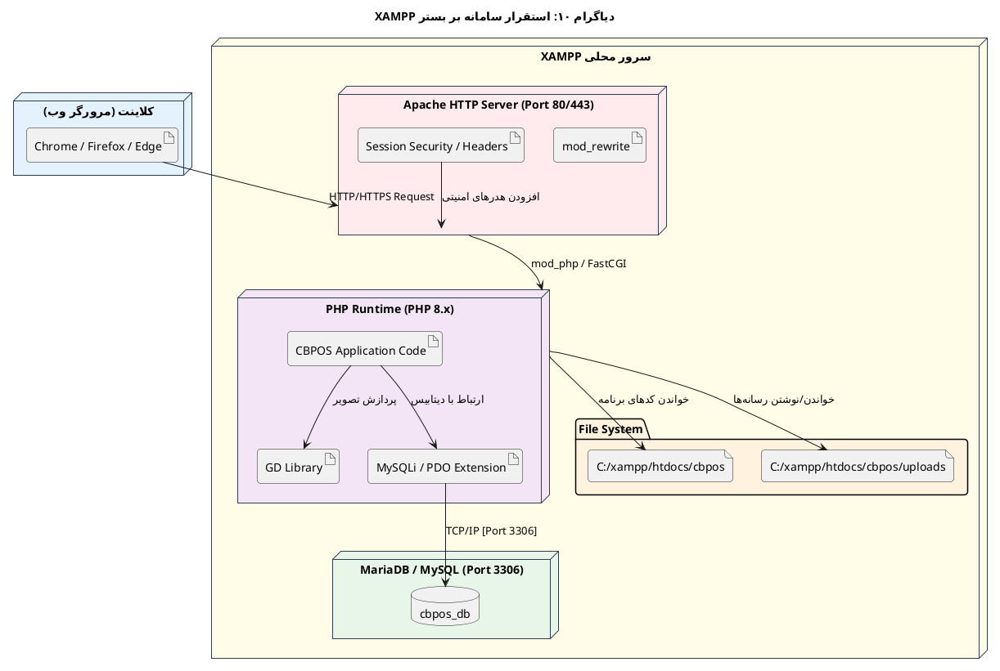

# سامانه مدیریت و فروشگاه برخط محصولات آرایشی و بهداشتی (CBPOS)

> **Cosmetics & Beauty Product Online Store — PHP OOP / XAMPP / MySQL**

این پروژه به‌عنوان **پایان‌نامه / پروژه کارشناسی ناپیوسته مهندسی حرفه‌ای کامپیوتر — گرایش نرم‌افزار** تهیه شده است. هدف اصلی پروژه، باز مهندسی نرم‌افزار، تحلیل نقادانه کد موجود، ارتقای امنیت، بهبود معماری و مستندسازی مهندسی نرم‌افزار بر اساس شواهد فنی و استانداردهای رایج توسعه وب است.


---

## اطلاعات پروژه

| مشخصه | اطلاعات |
|---|---|
| **نام پروژه** | سامانه مدیریت و فروشگاه برخط محصولات آرایشی و بهداشتی (CBPOS) |
| **دانشجو** | امیرعلی صالح پور |
| **استاد راهنما** | جناب استاد عباس حیدری پاشاکی |
| **مقطع و رشته** | کارشناسی ناپیوسته — مهندسی حرفه‌ای کامپیوتر (نرم‌افزار) |
| **دانشگاه** | دانشکده فنی و حرفه‌ای شهید چمران رشت — دوره روزانه |
| **تاریخ ارزیابی و دفاع** | آبان‌ماه ۱۴۰۵ / 1405/08 |
| **مخزن توسعه پروژه** | [Silent-Galaxy/cbpos](https://github.com/Silent-Galaxy/cbpos) |
| **منبع پایه و هسته اولیه** | [Cosmetics and Beauty Product Online Store — SourceCodester](https://www.sourcecodester.com/php/15181/cosmetics-and-beauty-product-online-store-phpoop-free-source-code.html) |
| **بستر اجرا** | XAMPP — Apache + MySQL/MariaDB + PHP OOP |
| **آدرس سمت کاربر** | `http://localhost/cbpos/` |
| **آدرس سمت مدیریت** | `http://localhost/cbpos/admin/` |

---

## فهرست مطالب

1. [چکیده و معرفی سیستم](#۱-چکیده-و-معرفی-سیستم)
2. [تحلیل نقادانه، مهندسی معکوس و باز مهندسی نرم‌افزار](#۲-تحلیل-نقادانه-مهندسی-معکوس-و-باز-مهندسی-نرم‌افزار)
3. [معماری و قابلیت‌های کارکردی سیستم](#۳-معماری-و-قابلیت‌های-کارکردی-سیستم)
4. [پیش‌نیازها و راهنمای راه‌اندازی روی XAMPP](#۴-پیش‌نیازها-و-راهنمای-راه‌اندازی-روی-xampp)
5. [ساختار فایل‌ها و ماژول‌های پروژه](#۵-ساختار-فایل‌ها-و-ماژول‌های-پروژه)
6. [مجموعه ۱۰ دیاگرام مهندسی نرم‌افزار با PlantUML](#۶-مجموعه-۱۰-دیاگرام-مهندسی-نرم‌افزار-با-plantuml)
7. [ارزیابی امنیتی و انطباق با OWASP Top 10](#۷-ارزیابی-امنیتی-و-انطباق-با-owasp-top-10)
8. [گالری تصاویر محیط برنامه](#۸-گالری-تصاویر-محیط-برنامه)
9. [چک‌لیست آزمون‌های پذیرش و دفاع](#۹-چک‌لیست-آزمون‌های-پذیرش-و-دفاع)
10. [محدودیت‌ها، نتیجه‌گیری و توسعه آتی](#۱۰-محدودیت‌ها-نتیجه‌گیری-و-توسعه-آتی)
11. [منابع و مستندات](#۱۱-منابع-و-مستندات)

---

## ۱. چکیده و معرفی سیستم

سامانه **CBPOS** یک فروشگاه آنلاین تحت وب برای مدیریت و فروش محصولات آرایشی، بهداشتی و مراقبت پوستی است. این سیستم با معماری شی‌گرا در PHP و پایگاه داده MySQL/MariaDB توسعه یافته و بر بستر **XAMPP** قابل اجراست.

پروژه حاضر صرفاً یک نصب ساده سورس آماده نیست؛ بلکه یک **پژوهش مهندسی نرم‌افزار** است که در آن کد پایه از منبع عمومی SourceCodester استخراج، مهندسی معکوس، تحلیل نقادانه و سپس بازسازی شده است. فرآیند اصلی پروژه شامل موارد زیر است:

- شناسایی نقاط ضعف معماری و امنیتی نسخه اولیه
- جایگزینی کوئری‌های ناامن با Prepared Statements
- ارتقای ذخیره‌سازی رمز عبور از الگوریتم‌های منسوخ به `password_hash()` با BCRYPT
- بهبود مدیریت نشست‌ها و مقابله با Session Fixation
- کنترل بهتر بارگذاری فایل‌ها و اعتبارسنجی MIME Type
- تحلیل گردش کار سفارش، موجودی انبار و فرآیند تسویه
- مستندسازی با ۱۰ دیاگرام استاندارد مهندسی نرم‌افزار

سیستم دارای دو سطح کاربری اصلی است:

### ۱.۱. پورتال مشتریان — Storefront

- مشاهده کاتالوگ محصولات
- فیلتر بر اساس دسته‌بندی و برند
- جستجوی کالا
- مشاهده موجودی بر اساس تنوع محصول — Variant
- مدیریت سبد خرید
- ثبت سفارش و پرداخت/ثبت روش پرداخت
- پیگیری وضعیت سفارشات
- مدیریت پروفایل کاربری

### ۱.۲. پیشخوان مدیریت — Admin Dashboard

- ورود امن مدیران
- داشبورد آماری فروش و موجودی
- مدیریت دسته‌بندی‌ها
- مدیریت برندها
- مدیریت محصولات
- مدیریت موجودی انبار — Stock In / Stock Out
- مدیریت سفارشات و تغییر وضعیت آن‌ها
- مدیریت کاربران مدیریتی
- تنظیمات اطلاعات عمومی فروشگاه
- گزارش‌گیری فروش

---

## ۲. تحلیل نقادانه، مهندسی معکوس و باز مهندسی نرم‌افزار

یکی از اهداف مهم این پروژه در سطح کارشناسی، نشان دادن توانایی **تحلیل انتقادی کد موجود** و ارتقای آن بر اساس شواهد فنی است. نسخه پایه پروژه از SourceCodester دریافت شد و سپس فرآیند باز مهندسی روی آن انجام گرفت.

### ۲.۱. خلاصه فرآیند باز مهندسی

```text
[نسخه پایه SourceCodester]
        │
        ├── نقایص امنیتی احتمالی: SQL Injection، XSS، هش ضعیف
        ├── coupling نسبتاً بالا در برخی بخش‌ها
        ├── ریسک همزمانی در عملیات موجودی
        └── نیاز به مستندسازی مهندسی نرم‌افزار
        │
        ▼
[تحلیل نقادانه + مهندسی معکوس]
        │
        ├── بازبینی جریان داده
        ├── شناسایی موجودیت‌های کلیدی
        ├── بررسی چرخه حیات سفارش
        └── ارزیابی ریسک‌های امنیتی
        │
        ▼
[باز مهندسی و بهبودهای مهندسی‌شده]
        │
        ├── Prepared Statements
        ├── password_hash / password_verify
        ├── session_regenerate_id
        ├── اعتبارسنجی فایل‌ها
        ├── تحلیل تراکنش موجودی
        └── مستندسازی با PlantUML
```

### ۲.۲. جدول تحلیل شواهدمحور نقاط ضعف و اقدامات اصلاحی

| ردیف | مشخصه در نسخه اولیه / Legacy | ریسک مهندسی یا امنیتی | اقدام اصلاحی در پروژه حاضر | شاهد فنی / استاندارد |
|---:|---|---|---|---|
| ۱ | استفاده از مقادیر ورودی مستقیم در SQL | SQL Injection | استفاده از Prepared Statements و bind parameter | OWASP A03:2021 — Injection |
| ۲ | ذخیره رمز عبور با MD5 یا روش‌های ضعیف | شکست رمزنگاری، Rainbow Table | استفاده از `password_hash()` با `PASSWORD_BCRYPT` و `password_verify()` | PHP Manual — Password Hashing |
| ۳ | رندر مستقیم ورودی کاربر بدون escape | Stored / Reflected XSS | پاکسازی ورودی و escape خروجی | OWASP A03:2021 — Injection / XSS |
| ۴ | عدم کنترل دقیق همزمانی در کسر موجودی | Overselling و مغایرت انبار | تحلیل تراکنش، قفل ردیف با `FOR UPDATE` و Rollback در خطا | اصل ACID در پایگاه داده |
| ۵ | بارگذاری فایل بدون بررسی واقعی نوع فایل | اجرای فایل مخرب / RCE | بررسی MIME Type، محدودیت پسوند، تغییر نام تصادفی فایل | OWASP File Upload Guidance |
| ۶ | مدیریت نشست ساده پس از ورود | Session Fixation / Hijacking | `session_regenerate_id(true)` و تنظیمات امن کوکی | OWASP Session Management |
| ۷ | مستندسازی فنی ناقص | کاهش قابلیت نگهداری | تهیه ۱۰ دیاگرام UML/PlantUML و ساختار ماژولار | IEEE / SWEBOK — Software Design |

### ۲.۳. دیدگاه نقادانه درباره محدودیت‌های نسخه پایه

نسخه پایه برای آموزش و راه‌اندازی سریع مناسب است، اما برای استفاده واقعی در محیط تولید کافی نیست. دلایل:

- امنیت کافی برای داده‌های واقعی کاربران ندارد.
- درگاه پرداخت واقعی به‌صورت پیش‌فرض پیکربندی نشده است.
- مدیریت همزمانی موجودی نیازمند تراکنش‌های دقیق‌تر است.
- تست خودکار واحد یا یکپارچه‌سازی ندارد.
- مستندسازی معماری و دیاگرام‌های رسمی ارائه نمی‌کند.

بنابراین پروژه حاضر با رویکرد **تحلیل، بهبود و مستندسازی** ارائه شده است.

---

## ۳. معماری و قابلیت‌های کارکردی سیستم

### ۳.۱. معماری کلی

سیستم بر پایه الگوی نزدیک به MVC و معماری لایه‌ای پیاده‌سازی شده است:

```text
Presentation Layer
│
├── Storefront UI
├── Admin Dashboard
└── AJAX / Static Assets

Business Logic Layer
│
├── Login / Authentication
├── Catalog / Master Actions
├── Cart / Checkout Engine
└── System Settings

Data Access Layer
│
├── DBConnection Wrapper
├── MySQLi / PDO Driver
└── Image Handler / Upload Service

Persistence Layer
│
├── MySQL / MariaDB — cbpos_db
└── Local File Storage — /uploads
```

### ۳.۲. قابلیت‌های سمت مشتری

- ثبت‌نام و ورود کاربر
- مشاهده صفحه اصلی فروشگاه
- مرور محصولات
- فیلتر محصولات بر اساس دسته
- فیلتر محصولات بر اساس برند
- جستجوی محصول
- مشاهده جزئیات محصول
- مشاهده تنوع‌ها و موجودی
- افزودن به سبد خرید
- ویرایش تعداد اقلام سبد
- حذف کالا از سبد
- ثبت سفارش
- انتخاب روش پرداخت
- مشاهده تاریخچه سفارشات
- لغو سفارش در وضعیت مجاز
- مدیریت پروفایل و رمز عبور

### ۳.۳. قابلیت‌های سمت مدیریت

- ورود امن مدیر
- داشبورد آماری
- مدیریت دسته‌بندی‌ها: CRUD
- مدیریت برندها: CRUD
- مدیریت محصولات: CRUD
- مدیریت موجودی و تنوع کالاها
- ثبت ورود کالا به انبار — Stock In
- ثبت خروج یا تعدیل موجودی — Stock Out / Adjustment
- مدیریت سفارشات
- مشاهده جزئیات سفارش
- تغییر وضعیت سفارش
- علامت‌گذاری سفارش به‌عنوان پرداخت‌شده
- مدیریت کاربران مدیریتی
- ویرایش اطلاعات حساب مدیر
- تنظیمات اطلاعات فروشگاه
- گزارش فروش تاریخ‌وار

---

## ۴. پیش‌نیازها و راهنمای راه‌اندازی روی XAMPP

این پروژه به‌طور خاص برای اجرا روی **XAMPP** تنظیم شده است.

### ۴.۱. نیازمندی‌های نرم‌افزاری

- XAMPP
- Apache
- MySQL یا MariaDB
- PHP نسخه ۷.۴ تا ۸.۲ — پیشنهادی: PHP 8.x
- ماژول GD Library فعال در `php.ini`
- مرورگر مدرن: Chrome، Firefox یا Edge
- Git — اختیاری، برای clone کردن مخزن

### ۴.۲. گام اول: قرار دادن پروژه در htdocs

اگر Git دارید:

```bash
cd C:/xampp/htdocs/
git clone https://github.com/Silent-Galaxy/cbpos.git
```

ساختار باید به این شکل باشد:

```text
C:/xampp/htdocs/cbpos/
```

اگر از ZIP استفاده می‌کنید، فایل فشرده را استخراج کرده و پوشه پروژه را با نام `cbpos` داخل `htdocs` قرار دهید.

### ۴.۳. گام دوم: فعال‌سازی GD Library

فایل زیر را باز کنید:

```text
C:/xampp/php/php.ini
```

عبارت زیر را جستجو کنید:

```ini
;extension=gd
```

سمیکالن ابتدای خط را حذف کنید تا به این شکل شود:

```ini
extension=gd
```

سپس Apache را از طریق XAMPP Control Panel Restart کنید.

### ۴.۴. گام سوم: اجرای Apache و MySQL

در XAMPP Control Panel:

- Apache را Start کنید.
- MySQL را Start کنید.

### ۴.۵. گام چهارم: ساخت پایگاه داده

به آدرس زیر بروید:

```text
http://localhost/phpmyadmin/
```

مراحل:

1. روی **New** کلیک کنید.
2. نام دیتابیس را دقیقاً设置为:

```text
cbpos_db
```

3. Collation پیشنهادی:

```text
utf8mb4_general_ci
```

4. دیتابیس را Create کنید.

### ۴.۶. گام پنجم: Import فایل SQL

وارد دیتابیس `cbpos_db` شوید.

به تب **Import** بروید.

فایل زیر را انتخاب کنید:

```text
C:/xampp/htdocs/cbpos/database/cbpos_db.sql
```

سپس دکمه **Go** یا **Import** را بزنید.

### ۴.۷. گام ششم: بررسی تنظیمات اتصال به دیتابیس

معمولاً تنظیمات پیش‌فرض XAMPP به این شکل است:

```php
define('DB_SERVER', "localhost");
define('DB_USERNAME', "root");
define('DB_PASSWORD', "");
define('DB_NAME', "cbpos_db");
```

در صورت نیاز، این مقادیر را در فایل‌های پیکربندی پروژه بررسی کنید.

### ۴.۸. گام هفتم: دسترسی به سیستم

سمت کاربر:

```text
http://localhost/cbpos/
```

سمت مدیریت:

```text
http://localhost/cbpos/admin/
```

### ۴.۹. اطلاعات پیش‌فرض ورود

| بخش | نام کاربری | رمز عبور | نقش |
|---|---|---|---|
| مدیریت | `admin` | `admin123` | مدیر کل سیستم |
| مشتری | از طریق Register ثبت‌نام کنید | رمز انتخابی کاربر | مشتری فروشگاه |

> تذکر امنیتی: این اطلاعات فقط برای محیط توسعه محلی XAMPP است. در محیط واقعی حتماً رمزها تغییر کنند.

### ۴.۱۰. عیب‌یابی رایج

| مشکل | علت احتمالی | راه‌حل |
|---|---|---|
| خطای اتصال به دیتابیس | MySQL روشن نیست یا نام دیتابیس اشتباه است | MySQL را Start کنید و `cbpos_db` را بررسی کنید |
| تصاویر آپلود نمی‌شوند | GD Library غیرفعال است | در `php.ini` خط `extension=gd` را فعال کنید |
| صفحه 404 نمایش داده می‌شود | پوشه پروژه نام دیگری دارد | پوشه باید دقیقاً `cbpos` نام داشته باشد |
| رمز admin کار نمی‌کند | SQL import نشده یا داده پایه وجود ندارد | فایل `cbpos_db.sql` را مجدد Import کنید |
| خطای MIME فایل | آپلود فایل غیرمجاز است | فقط فرمت‌های مجاز تصویر مانند JPG، PNG، WEBP استفاده شود |
| مشکل نمایش فارسی | Encoding نامناسب | دیتابیس با `utf8mb4` و صفحات با UTF-8 ذخیره شوند |

---

## ۵. ساختار فایل‌ها و ماژول‌های پروژه

```text
cbpos/
├── admin/                         # پنل مدیریت
│   ├── home.php                   # داشبورد مدیریتی
│   ├── inc/                       # هدر، منو، فوتر ادمین
│   ├── inventory/                 # مدیریت موجودی انبار
│   ├── orders/                    # مدیریت سفارشات
│   ├── product/                   # مدیریت محصولات
│   ├── system_info/               # تنظیمات اطلاعات فروشگاه
│   └── index.php                  # ورود به پنل مدیریت
│
├── classes/                       # لایه منطق شی‌گرا
│   ├── DBConnection.php           # اتصال امن به دیتابیس
│   ├── Login.php                  # احراز هویت و مدیریت نشست
│   ├── Master.php                 # عملیات CRUD و فرآیندهای اصلی
│   └── SystemSettings.php         # تنظیمات سیستم
│
├── database/                      # اسکریپت پایگاه داده
│   └── cbpos_db.sql
│
├── dist/                          # فایل‌های استاتیک CSS/JS/Fonts
├── libs/                          # کتابخانه‌ها و افزونه‌ها
├── uploads/                       # تصاویر محصولات و برندها
│
├── docs/
│   ├── screenshots/               # اسکرین‌شات محیط برنامه
│   └── diagrams/                  # خروجی دیاگرام‌های PlantUML
│
├── index.php                      # صفحه اصلی فروشگاه
├── initialize.php                 # مقداردهی اولیه و تنظیمات
├── cart.php                       # سبد خرید
├── checkout.php                   # تسویه و ثبت سفارش
├── products.php                   # لیست و فیلتر محصولات
└── README.md                      # مستند نهایی پروژه
```

---

## ۶. مجموعه ۱۰ دیاگرام مهندسی نرم‌افزار با PlantUML

کدهای زیر با **PlantUML** نوشته شده‌اند. برای مشاهده، هر بلوک کد را در سایت زیر قرار دهید:

🔗 [https://editor.plantuml.com/](https://editor.plantuml.com/)

برای گزارش نهایی، خروجی `SVG` یا `PNG` هر دیاگرام را در پوشه `docs/diagrams/` ذخیره کنید.

---

### دیاگرام ۱: نمودار موارد کاربرد سامانه — Use Case Diagram

این دیاگرام تعاملات مشتری، مدیر و ماژول پرداخت را نشان می‌دهد.



---

### دیاگرام ۲: نمودار کلاس‌های کلیدی و دامنه شی‌گرا — Class Diagram

این دیاگرام ساختار کلاس‌های اصلی، روابط آن‌ها و تفکیک لایه منطق تجاری از لایه داده را نشان می‌دهد.



---

### دیاگرام ۳: مدل داده‌ای موجودیت–رابطه پایگاه داده — ERD

این دیاگرام جداول اصلی پایگاه داده `cbpos_db`، کلیدهای اصلی/خارجی و روابط بین موجودیت‌ها را نشان می‌دهد.



---

### دیاگرام ۴: نمودار توالی احراز هویت و امنیت نشست — Authentication Sequence Diagram

این دیاگرام فرآیند ورود کاربر، بررسی CSRF، اعتبارسنجی رمز با هش امن و بازتولید شناسه نشست را نشان می‌دهد.



---

### دیاگرام ۵: نمودار توالی ثبت سفارش، قفل موجودی و پرداخت — Checkout Sequence Diagram

این دیاگرام فرآیند atomic ثبت سفارش، بررسی موجودی، کسر انبار، پاک‌سازی سبد و COMMIT/ROLLBACK را نشان می‌دهد.



---

### دیاگرام ۶: نمودار فعالیت گردش کار خرید از سبد تا تسویه — Checkout Activity Diagram

این دیاگرام جریان خرید مشتری را از انتخاب محصول تا صدور فاکتور یا خطای موجودی نشان می‌دهد.



---

### دیاگرام ۷: نمودار فعالیت مدیریت زنجیره تأمین و انبارداری — Inventory Activity Diagram

این دیاگرام فرآیند Stock In، Stock Out، تعدیل موجودی و هشدار کمبود کالا را نشان می‌دهد.



---

### دیاگرام ۸: نمودار ماشین حالت چرخه حیات سفارش — Order Lifecycle State Machine

این دیاگرام وضعیت‌های معتبر سفارش و گذار بین آن‌ها را نشان می‌دهد.



---

### دیاگرام ۹: نمودار قطعات و معماری لایه‌ای سامانه — Component Diagram

این دیاگرام جداسازی لایه ارائه، منطق تجاری، دسترسی به داده و ماندگاری را نشان می‌دهد.



---

### دیاگرام ۱۰: نمودار استقرار بستر سخت‌افزاری و نرم‌افزاری در XAMPP — Deployment Diagram

این دیاگرام توپولوژی اجرای پروژه روی localhost، Apache، PHP، MariaDB/MySQL و file system را نشان می‌دهد.



---

## ۷. ارزیابی امنیتی و انطباق با OWASP Top 10

در این پروژه، تلاش شده است تا مهم‌ترین ریسک‌های امنیتی اپلیکیشن‌های وب تحت PHP مورد توجه قرار بگیرند.

### ۷.۱. مقابله با SQL Injection

رویکرد ناامن نمونه:

```php
// ناامن — فقط برای نمایش مفهوم
$query = "SELECT * FROM users WHERE username = '" . $_POST['username'] . "'";
```

رویکرد بهبودیافته:

```php
$stmt = $conn->prepare("SELECT id, password, type FROM users WHERE username = ?");
$stmt->bind_param("s", $username);
$stmt->execute();
$result = $stmt->get_result();
```

### ۷.۲. ذخیره‌سازی امن رمز عبور

به‌جای الگوریتم‌های منسوخ مانند MD5، از توابع امن PHP استفاده می‌شود:

```php
$hashed = password_hash($password, PASSWORD_BCRYPT);

if (password_verify($inputPassword, $storedHash)) {
    // رمز صحیح است
}
```

### ۷.۳. امنیت نشست

پس از ورود موفق:

```php
session_regenerate_id(true);
```

همچنین تنظیمات پیشنهادی کوکی:

```php
ini_set('session.cookie_httponly', 1);
ini_set('session.cookie_samesite', 'Strict');
ini_set('session.use_strict_mode', 1);
```

### ۷.۴. بارگذاری امن فایل

برای تصاویر محصولات:

- بررسی پسوند مجاز
- بررسی MIME Type واقعی
- محدودیت حجم فایل
- تغییر نام تصادفی فایل
- غیرفعال کردن اجرای PHP در پوشه `uploads/`

مثال مفهومی:

```php
$finfo = finfo_open(FILEINFO_MIME_TYPE);
$mimeType = finfo_file($finfo, $tmpPath);
finfo_close($finfo);

$allowed = [
    'image/jpeg',
    'image/png',
    'image/webp'
];

if (!in_array($mimeType, $allowed, true)) {
    die("نوع فایل مجاز نیست.");
}
```

### ۷.۵. جدول انطباق با OWASP Top 10 — 2021

| ریسک OWASP | وضعیت در پروژه | توضیح |
|---|---|---|
| A01 Broken Access Control | بهبود نسبی | کنترل نقش مدیر/مشتری در لایه ورود و پنل ادمین |
| A02 Cryptographic Failures | بهبود | استفاده از `password_hash` به‌جای MD5 |
| A03 Injection | بهبود | استفاده از Prepared Statements |
| A04 Insecure Design | تحلیل شده | دیاگرام‌های حالة سفارش، موجودی و checkout تهیه شده |
| A05 Security Misconfiguration | نیازمند توجه در production | در XAMPP محلی قابل قبول، ولی برای سرور واقعی باید hardening شود |
| A06 Vulnerable Components | محدود | کتابخانه‌های شخص ثالث باید به‌روزرسانی شوند |
| A07 Identification and Authentication Failures | بهبود | regenerate session، verify password، CSRF check |
| A08 Software and Data Integrity Failures | نسبی | اعتبارسنجی آپلود فایل و کنترل ورودی |
| A09 Logging and Monitoring | محدود | برای پروژه دانشجویی لاگ کامل پیاده‌سازی نشده |
| A10 SSRF | کم‌ریسک | در نسخه محلی کمتر کاربرد دارد |

---

## ۸. گالری تصاویر محیط برنامه

پس از اجرای پروژه روی XAMPP، اسکرین‌شات‌های زیر تهیه و در پوشه `docs/screenshots/` قرار داده شوند.

### ۸.۱. سمت کاربر — Storefront

| کاتالوگ محصولات | سبد خرید |
|---|---|
|  |  |
| *مرور محصولات آرایشی، برندها و دسته‌بندی‌ها* | *مشاهده اقلام انتخابی و محاسبه مبلغ کل* |

| صفحه تسویه | تاریخچه سفارشات |
|---|---|
|  |  |
| *ورود آدرس، انتخاب روش پرداخت و ثبت نهایی* | *مشاهده وضعیت سفارش‌ها و پیگیری* |

### ۸.۲. سمت مدیریت — Admin Dashboard

| داشبورد مدیریتی | مدیریت محصولات |
|---|---|
|  |  |
| *نمایش شاخص‌های فروش، سفارش‌ها و موجودی* | *افزودن، ویرایش و حذف محصولات* |

| مدیریت انبار | مدیریت سفارشات |
|---|---|
|  |  |
| *Stock In / Stock Out و کنترل Variantها* | *تغییر وضعیت سفارش و رسیدگی به پرداخت* |

> اگر هنوز اسکرین‌شات‌ها را اضافه نکرده‌اید، می‌توانید موقتاً این بخش را با توضیح «در نسخه نهایی گزارش، تصاویر اضافه خواهد شد» تحویل دهید؛ اما برای دفاع نهایی حتماً تصاویر واقعی از `http://localhost/cbpos/` و `http://localhost/cbpos/admin/` اضافه کنید.

---

## ۹. چک‌لیست آزمون‌های پذیرش و دفاع

برای نشان دادن کیفیت مهندسی پروژه، موارد زیر به‌عنوان آزمون‌های دستی پیشنهاد می‌شوند.

| شناسه آزمون | سناریو | ورودی | نتیجه مورد انتظار |
|---|---|---|---|
| TC-01 | ورود مدیر | `admin / admin123` | هدایت به داشبورد ادمین |
| TC-02 | ثبت‌نام مشتری | فرم Register با داده معتبر | ایجاد حساب و امکان ورود |
| TC-03 | افزودن به سبد | انتخاب محصول و Variant | ثبت رکورد در `cart` |
| TC-04 | ثبت سفارش موفق | موجودی کافی | ایجاد `order` و `order_items` و کسر موجودی |
| TC-05 | ثبت سفارش با موجودی ناکافی | تعداد بیشتر از موجودی | Rollback و پیام خطا |
| TC-06 | تغییر وضعیت سفارش | مدیر وضعیت را Confirm/Packed/Shipped می‌کند | به‌روزرسانی `orders.status` |
| TC-07 | لغو سفارش | سفارش Pending لغو شود | بازگشت موجودی در صورت پیاده‌سازی سیاست لغو |
| TC-08 | SQL Injection | ورودی `' OR 1=1 --` در فرم لاگین | ورود موفق نباشد |
| TC-09 | آپلود فایل مخرب | فایل PHP با پسوند تصویر | رد شدن توسط اعتبارسنجی MIME/پسوند |
| TC-10 | گزارش فروش | بازه تاریخ معتبر | نمایش گزارش تاریخ‌وار |

### نمونه پرسش‌های دفاع

1. چرا از Prepared Statements استفاده شده است؟
2. تفاوت `password_hash` با MD5 چیست؟
3. Session Fixation چگونه رخ می‌دهد و `session_regenerate_id` چه می‌کند؟
4. اگر دو کاربر همزمان آخرین موجودی یک کالا را بخرند، چه اتفاقی می‌افتد؟
5. نقش جدول `order_items` چیست؟
6. چرا موجودی بر اساس Variant مدیریت می‌شود؟
7.差异 بین Stock In و Stock Out چیست؟
8. چرا دیاگرام ERD برای درک پایگاه داده مهم است؟
9. معماری لایه‌ای چه مزیتی دارد؟
10. این سیستم برای محیط production چه کمبودهایی دارد؟

---

## ۱۰. محدودیت‌ها، نتیجه‌گیری و توسعه آتی

### ۱۰.۱. محدودیت‌های فعلی

- اجرای پروژه بر بستر محلی XAMPP است.
- درگاه پرداخت واقعی بانکی متصل نشده است.
- تست خودکار واحد و یکپارچه‌سازی کامل ندارد.
- سیستم لاگ‌گیری و مانیتورینگ پیشرفته پیاده‌سازی نشده است.
- برای استفاده تجاری واقعی نیاز به hardening، backup، HTTPS و مدیریت خطا دارد.

### ۱۰.۲. نتیجه‌گیری

پروژه CBPOS در این نسخه، از یک سورس آموزشی پایه فراتر رفته و به یک نمونه تحلیل‌شده، مستندسازی‌شده و بهبودیافته تبدیل شده است. مهم‌ترین دستاوردهای پروژه عبارتند از:

- مهندسی معکوس سیستم موجود
- شناسایی ریسک‌های امنیتی و معماری
- بهبود فرآیندهای احراز هویت و ثبت سفارش
- مستندسازی با ۱۰ دیاگرام حرفه‌ای
- ارائه راهنمای راه‌اندازی دقیق روی XAMPP
- آماده‌سازی بستر برای توسعه‌های آینده

### ۱۰.۳. توسعه آتی

1. اتصال به درگاه پرداخت واقعی ایرانی مانند شاپرک/زرین‌پال/آیدی‌پی
2. پیاده‌سازی RESTful API برای اپلیکیشن موبایل
3. افزودن سیستم تخفیف، کوپن و کمپین فروش
4. پیاده‌سازی تست‌های PHPUnit و Pest
5. افزودن لاگ‌گیری مرکزی و پنل مانیتورینگ
6. بهبود سئو و تولید صفحه محصول پویا
7. افزودن موتور پیشنهاد محصول بر اساس خریدهای قبلی
8. مهاجرت به Framework مدرن مانند Laravel در نسخه‌های آینده

---

## ۱۱. منابع و مستندات

- مخزن پروژه:  
  [https://github.com/Silent-Galaxy/cbpos](https://github.com/Silent-Galaxy/cbpos)

- منبع پایه سورس‌کد:  
  [https://www.sourcecodester.com/php/15181/cosmetics-and-beauty-product-online-store-phpoop-free-source-code.html](https://www.sourcecodester.com/php/15181/cosmetics-and-beauty-product-online-store-phpoop-free-source-code.html)

- ویرایشگر آنلاین PlantUML:  
  [https://editor.plantuml.com/](https://editor.plantuml.com/)

- مستندات PHP — Password Hashing:  
  [https://www.php.net/manual/en/function.password-hash.php](https://www.php.net/manual/en/function.password-hash.php)

- مستندات PHP — MySQLi Prepared Statements:  
  [https://www.php.net/manual/en/mysqli.quickstart.prepared-statements.php](https://www.php.net/manual/en/mysqli.quickstart.prepared-statements.php)

- مستندات PHP — session_regenerate_id:  
  [https://www.php.net/manual/en/function.session-regenerate-id.php](https://www.php.net/manual/en/function.session-regenerate-id.php)

- OWASP Top Ten 2021:  
  [https://owasp.org/www-project-top-ten/](https://owasp.org/www-project-top-ten/)

- OWASP Session Management Cheat Sheet:  
  [https://cheatsheetseries.owasp.org/cheatsheets/Session_Management_Cheat_Sheet.html](https://cheatsheetseries.owasp.org/cheatsheets/Session_Management_Cheat_Sheet.html)

- OWASP File Upload Cheat Sheet:  
  [https://cheatsheetseries.owasp.org/cheatsheets/File_Upload_Cheat_Sheet.html](https://cheatsheetseries.owasp.org/cheatsheets/File_Upload_Cheat_Sheet.html)

---

## تهیه‌کننده

**دانشجو:** امیرعلی صالح پور  
**استاد راهنما:** جناب استاد عباس حیدری پاشاکی  
**دانشکده فنی و حرفه‌ای شهید چمران رشت**  
**مقطع:** کارشناسی ناپیوسته — مهندسی حرفه‌ای کامپیوتر، گرایش نرم‌افزار  
**تاریخ:** آبان‌ماه ۱۴۰